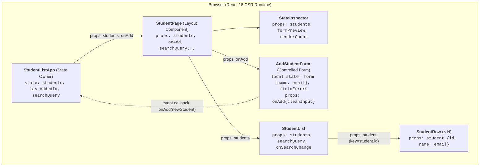
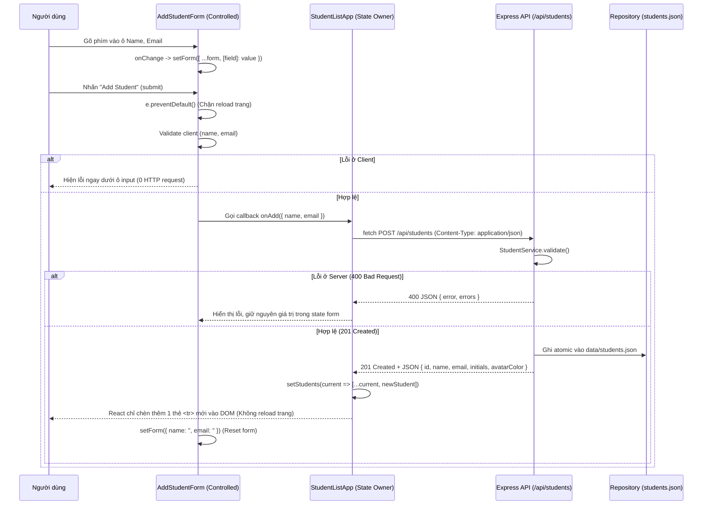

# Block #4 — Student Manager (Client-Side Rendering / CSR)

**Nhóm:** Group 02 (`24127043` - `24127144` - `24127491`)  
**Môn học:** Phát triển ứng dụng web (`CSC13008`) — Tuần 2 (Block #4)

Ứng dụng quản lý danh sách sinh viên được xây dựng theo mô hình **Client-Side Rendering (CSR)** với **React 18** ở trình duyệt và **Express JSON API** (`/api/students`) lưu trữ bền vững vào `data/students.json`.

```bash
npm install
npm run dev     # Mở http://localhost:3000/students
```

---

## 1. Sơ đồ Component và State Owner (Single Source of Truth)

### Sơ đồ phân cấp Component & Luồng dữ liệu (`Props` ↓ / `Events` ↑)



### Quyền sở hữu State (State Ownership)

| State | Component sở hữu (Owner) | Lý do thiết kế |
| :--- | :--- | :--- |
| `students` *(Danh sách sinh viên)* | **`StudentListApp`** ([`src/public/js/app-csr.js`](src/public/js/app-csr.js)) | **Single Source of Truth**: Cả `AddStudentForm` (nơi thêm mới), `StudentList` (nơi hiển thị bảng) và `StateInspector` (nơi đếm số lượng) đều phụ thuộc vào danh sách này, nên state phải được đặt ở tổ tiên chung (`StudentListApp`). |
| `form` (`{ name, email }`) & `fieldErrors` | **`AddStudentForm`** ([`src/public/js/components/AddStudentForm.js`](src/public/js/components/AddStudentForm.js)) | **Controlled Form State**: Chỉ liên quan đến quá trình người dùng gõ phím và validate trước khi submit. Sau khi submit thành công, `AddStudentForm` tự reset về `{ name: '', email: '' }`. |
| `searchQuery` | **`StudentListApp`** | Cho phép lọc danh sách hiển thị trong `StudentList` mà không làm thay đổi mảng `students` gốc. |

---

## 2. Luồng hoạt động CSR: Từ HTML Shell đến Cập nhật UI không Reload

### 2.1. Khi tải trang lần đầu (`HTML Shell → JavaScript → UI`)

1. **HTML Shell gần như rỗng:** Khi trình duyệt gửi `GET /students`, [`StudentController.serveAppShell`](src/controllers/student.controller.js) không dùng template engine (không dùng EJS) mà trả thẳng file tĩnh [`src/public/index.html`](src/public/index.html). Nếu bấm **View Page Source (`Ctrl + U`)**, trong `<body>` chỉ có duy nhất:
   ```html
   <div id="root" class="flex-1 flex flex-col"></div>
   ```
2. **JavaScript khởi tạo UI:** Trình duyệt tải React và các file component. `StudentListApp` khởi tạo state ban đầu từ `SEED_STUDENTS` ([`src/public/js/seed.js`](src/public/js/seed.js)) để render giao diện ngay lập tức, sau đó `useEffect` gọi `fetch('/api/students')` lấy JSON từ server và cập nhật `setStudents(data)`.

### 2.2. Khi thêm sinh viên mới (`Event → Fetch JSON → setState → Re-render`)



---

## 3. Phân tích Network trước và sau khi Submit

| Thời điểm | Bộ lọc `Doc` (Document) | Bộ lọc `Fetch/XHR` | Giải thích |
| :--- | :--- | :--- | :--- |
| **1. Tải trang `/students` lần đầu** | Có **1 request** duy nhất: `GET /students` (`200 text/html` — trả về HTML shell `<div id="root"></div>`) | Có **1 request**: `GET /api/students` (`200 application/json` — trả về mảng JSON sinh viên) | Server tách biệt hoàn toàn phần khung HTML tĩnh (shell) và dữ liệu thô (JSON). |
| **2. Nhấn Submit thêm Student hợp lệ** | **Không có bất kỳ request mới nào** (vẫn chỉ có 1 dòng từ lúc mở trang) | Có **1 request**: `POST /api/students` (`201 Created`, trả về JSON của sinh viên vừa tạo) | Nhờ `e.preventDefault()` và `fetch()`, trình duyệt không điều hướng trang và không tải lại HTML document. |
| **3. Nhấn Submit khi dữ liệu rỗng / sai email** | **Không có request mới** | **Không có request mới** (nếu bị chặn ở client) hoặc `POST /api/students` trả `400 Bad Request` JSON | Không cần server render lại toàn bộ trang HTML để báo lỗi như SSR; dữ liệu đang nhập vẫn nằm nguyên trong `form` state của trình duyệt. |

> **Kiểm chứng `View Page Source` vs `Elements (DOM)`:**
> - **View Page Source (`Ctrl + U`):** Luôn chỉ hiển thị `<div id="root"></div>` dù đã thêm bao nhiêu sinh viên.
> - **Tab `Elements` (F12):** Hiển thị đầy đủ bảng `<table id="students-table">` và mỗi lần thêm sinh viên chỉ có thêm đúng **1 node `<tr>` mới** được React gắn vào `<tbody>`.

---

## 4. Giải thích đoạn Code trọng tâm

### 4.1. State Owner & Immutable State Update — [`src/public/js/app-csr.js`](src/public/js/app-csr.js)

```javascript
function StudentListApp() {
  const [students, setStudents] = useState(SEED_STUDENTS);

  async function addStudent(cleanInput) {
    const res = await fetch('/api/students', {
      method: 'POST',
      headers: { 'Content-Type': 'application/json', Accept: 'application/json' },
      body: JSON.stringify(cleanInput),
    });
    const payload = await res.json();
    if (!res.ok) return { ok: false, error: payload.error };

    // Tạo mảng mới thay vì mutate mảng cũ
    setStudents((current) => [...current, enrichStudent(payload, current.length)]);
    return { ok: true };
  }

  return <StudentPage students={students} onAdd={addStudent} ... />;
}
```

- **Tại sao không dùng biến thường (`let students = ...`)?** Biến thường thay đổi không báo hiệu cho React biết để gọi lại hàm component, dẫn tới giao diện đứng yên không cập nhật.
- **Tại sao phải viết `setStudents(current => [...current, newStudent])` thay vì `students.push(newStudent)`?**
  React so sánh tham chiếu (`Object.is(prevState, nextState)`) để quyết định có re-render hay không. Nếu mutate trực tiếp mảng cũ bằng `.push()`, địa chỉ vùng nhớ của mảng không đổi nên React bỏ qua việc cập nhật UI. Toán tử spread `[...current, newStudent]` tạo ra một mảng mới hoàn toàn, kích hoạt React re-render chính xác.

### 4.2. Controlled Input & Chặn Reload — [`src/public/js/components/AddStudentForm.js`](src/public/js/components/AddStudentForm.js)

```javascript
const [form, setForm] = useState({ name: '', email: '' });

async function handleSubmit(e) {
  e.preventDefault(); // Chặn hành vi submit điều hướng trang mặc định của trình duyệt
  const { isValid, nextErrors, clean } = validateFields(form);
  setFieldErrors(nextErrors);
  if (!isValid) return;

  const result = await onAdd(clean);
  if (result.ok) {
    setForm({ name: '', email: '' }); // Reset form ngay bằng cách cập nhật state
  }
}
```

- **Controlled Input (`value={form.name}` + `onChange`):** Giá trị hiển thị trong ô `<input>` luôn do React state quyết định. Nhờ đó việc kiểm tra lỗi theo thời gian thực và việc xóa trắng form sau khi thêm (`setForm({ name: '', email: '' })`) chỉ cần một lệnh cập nhật state mà không cần can thiệp DOM thủ công.
- **`e.preventDefault()`:** Nếu thiếu dòng này, trình duyệt sẽ thực hiện hành vi mặc định của thẻ `<form>` là gửi một HTTP request điều hướng trang và reload toàn bộ document.

---

## 5. Đối chiếu SSR (Block #3) và CSR (Block #4)

| Tiêu chí | Block #3 — SSR (`Express + EJS`) | Block #4 — CSR (`React State + JSON API`) |
| :--- | :--- | :--- |
| **Nơi tạo HTML** | Server (EJS biên dịch data + template thành HTML) | Browser (React chạy JavaScript tạo DOM từ state) |
| **Response khi mở `/students`** | HTML hoàn chỉnh chứa sẵn các thẻ `<tr>` | HTML shell rỗng (`<div id="root"></div>`), sau đó lấy JSON từ `GET /api/students` |
| **Khi nhấn Add Student** | `POST /students` (form-urlencoded) → Server trả `302 Redirect` → Browser gọi tiếp `GET /students` (tải lại toàn trang) | `e.preventDefault()` → `POST /api/students` (JSON) → Server trả `201 Created` JSON → `setStudents` chỉ thêm 1 dòng `<tr>` |
| **Tải lại toàn trang (Document Reload)** | Có (mỗi lần submit là 1 vòng PRG tải lại document) | **Không (`0` document request mới)** |
| **Khi tắt JavaScript** | Vẫn xem được danh sách và submit được form | Chỉ thấy trang trắng (`<div id="root"></div>`) |

---

## 6. Quyết định kiến trúc & Lý do lựa chọn công nghệ (Architecture Decisions & Tech Justification)

Hệ thống được thiết kế dựa trên các mục tiêu cốt lõi: **đúng bản chất CSR**, **tách biệt rõ ràng ranh giới Network**, **tối giản không phụ thuộc công cụ build phức tạp**, và **dễ dàng kiểm thử độc lập**. Dưới đây là phân tích chi tiết vì sao nhóm lựa chọn kiến trúc này và lý do không chọn các giải pháp công nghệ thay thế:

### 6.1. Tại sao chọn React 18 UMD (No Bundler) thay vì Vite / Webpack / Create React App?
- **Lý do chọn React 18 UMD:**
  - Cho phép người chấm bài chạy ngay dự án chỉ với `npm install` và `npm start` mà không cần cài đặt các công cụ build tool phức tạp, tránh triệt để lỗi không tương thích phiên bản Node.js hay bundler caching.
  - Phản ánh trung thực và rõ ràng nhất cơ chế nạp của CSR: Trình duyệt nhận về một file HTML shell rỗng (`<div id="root"></div>`), tải các file `.js` độc lập, và React mount UI trực tiếp trong runtime của client mà không qua bất kỳ lớp đóng gói (bundle) làm mờ đi ranh giới mạng.
- **Tại sao không chọn Vite / Webpack / Create React App:**
  - Các build tool này tạo ra thêm một tầng trừu tượng (bundling, code-splitting, HMR proxy dev-server). Khi chạy dev server (như Vite `localhost:5173`), dev-server tự động inject hàng loạt script nội bộ làm nhiễu tab Network khi đối chiếu giữa SSR và CSR.
  - Kích thước dự án tăng đột biến (hàng trăm MB dependencies chỉ dành cho build tool), không cần thiết cho một micro-app tập trung vào kiến trúc state cơ bản.

### 6.2. Tại sao chọn React State (Declarative) thay vì Vanilla JS DOM Manipulation (`document.createElement`, `innerHTML`, jQuery)?
- **Lý do chọn React Declarative State:**
  - **Single Source of Truth:** Giao diện là hàm thuần túy của State ($UI = f(State)$). Khi thêm sinh viên, ta chỉ cần cập nhật mảng state `setStudents(...)`, React sẽ tự động tính toán Virtual DOM và cập nhật đúng node `<tr>` tương ứng.
  - **Bảo mật XSS tự động:** React tự động escape tất cả giá trị đầu vào của người dùng trước khi render, ngăn chặn triệt để lỗ hổng Cross-Site Scripting (XSS).
  - **Dễ mở rộng:** Khi bổ sung tính năng tìm kiếm (`searchQuery`) hay hiển thị trạng thái `StateInspector`, toàn bộ các thành phần đều dùng chung mảng `students` mà không bị hiện tượng xung đột dữ liệu.
- **Tại sao không chọn Vanilla JS DOM (`innerHTML`, jQuery):**
  - **Hiện tượng "Split-Brain" (Bất đồng bộ dữ liệu & DOM):** Lập trình viên phải vừa quản lý mảng dữ liệu trong bộ nhớ, vừa tự viết code chèn thẻ HTML vào bảng. Khi có thao tác xóa, lọc tìm kiếm hoặc validate lỗi, việc đồng bộ thủ công giữa DOM và mảng dữ liệu rất dễ phát sinh lỗi logic và rò rỉ bộ nhớ.
  - **Nguy cơ bảo mật:** Việc nối chuỗi `table.innerHTML += '<tr><td>' + name + '</td></tr>'` cực kỳ nguy hiểm nếu người dùng nhập ký tự `<script>` hoặc mã độc HTML.

### 6.3. Tại sao chọn React thay vì các Framework khác (Vue, Angular, Svelte)?
- **Tại sao không chọn Angular:**
  - Angular có cấu trúc quá nặng (Full-fledged framework với TypeScript bắt buộc, RxJS, Dependency Injection, NgModule). Chi phí thiết lập (boilerplate) quá lớn và cồng kềnh đối với bài tập tuần 2.
- **Tại sao không chọn Vue / Svelte:**
  - Vue hỗ trợ cơ chế 2-way data binding (`v-model`) và Svelte sử dụng cú pháp compiler magic (`count += 1`), điều này làm che giấu đi luồng dữ liệu 1 chiều (Unidirectional Data Flow) vốn là trọng tâm cần chứng minh trong bài học: *Props đi xuống, Event callbacks đi lên, và State Owner kiểm soát toàn bộ biến đổi trạng thái*.
  - React có mô hình phân định State Owner rõ ràng nhất thông qua cơ chế so sánh tham chiếu bất biến (Immutable State).

### 6.4. Tại sao tách rời Express REST API thay vì Full-Stack Framework (Next.js, Remix, Nuxt)?
- **Lý do chọn Decoupled Express JSON API:**
  - Giữ ranh giới mạng (network boundary) hoàn toàn tường minh: Front-end (Client UI) chỉ giao tiếp với Back-end thông qua các endpoint RESTful chuẩn (`GET /api/students`, `POST /api/students`).
  - Cho phép người quan sát phân biệt rõ ràng: HTTP request nào là lấy HTML Shell (`GET /students`), và HTTP request nào là trao đổi dữ liệu JSON (`POST /api/students`).
- **Tại sao không chọn Next.js / Remix:**
  - Next.js kết hợp chặt chẽ giữa Server Components, SSR và Hydration. Khi truy cập trang, Next.js mặc định render sẵn HTML ở server (Pre-rendering), làm mất đi tính chất "HTML Shell rỗng" cần có của bài toán CSR thuần túy.
  - Tính năng Server Actions của Next.js che giấu cơ chế HTTP POST JSON truyền thống, không phù hợp cho mục tiêu học tập về giao thức mạng web.

### 6.5. Tại sao chọn Atomic JSON File Storage thay vì Cơ sở dữ liệu quan hệ (PostgreSQL, MySQL, MongoDB)?
- **Lý do chọn Atomic JSON File Storage:**
  - Đảm bảo tính lưu trữ bền vững (dữ liệu không bị mất khi reload hoặc restart server) với cơ chế Atomic Write (ghi ra file tạm `.tmp` rồi đổi tên `rename`), chống hỏng file khi có ghi đồng thời.
  - **Không phụ thuộc môi trường:** Không đòi hỏi người chấm bài phải cài đặt service MySQL/PostgreSQL hay cấu hình Docker container trên máy cá nhân. Dự án tự vận hành độc lập (self-contained) 100%.
- **Tại sao không chọn DBMS:**
  - Phạm vi bài tập tuần 2 tập trung vào cơ chế Client-Side Rendering và tương tác Network của trình duyệt, việc dựng thêm hệ quản trị CSDL là phức tạp hóa không cần thiết (Over-engineering).
